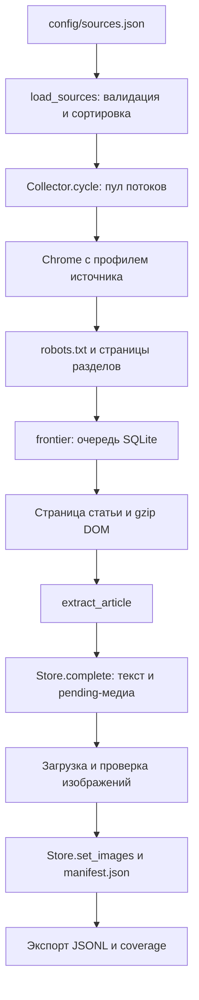
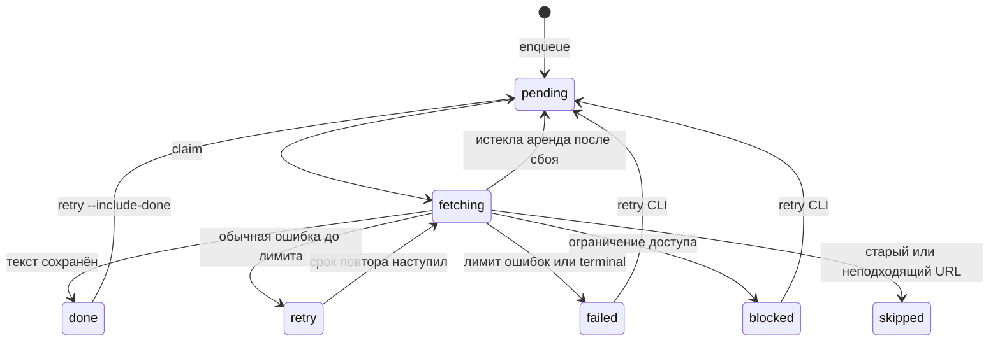

# Архитектура сборщика

[Навигация для агентов](../AGENTS.md) · [Данные](DATA_CONTRACT.md) · [Источники](SOURCES.md) · [Эксплуатация](OPERATIONS.md)

## Исполняемая модель

Сборщик — локальная CLI-программа Python. Точка входа: `python -m news_collector`; `__main__.py` вызывает `cli.main()`. В pyproject также объявлен entry point `alfa-news`. Команды ожидают рабочий каталог `parser/`, если явно не переданы пути.

Сайты не находятся поиском по интернету. `Source` описывает конкретный издательский домен и разделы, а общий движок обнаруживает статьи, извлекает данные и записывает результат. Сейчас используется JSON-конфигурация, а не Python-класс адаптера для каждого издания.

## Карта модулей

| Модуль | Ответственность | Основные точки расширения |
|---|---|---|
| `cli.py` | Аргументы, сигналы, файловая блокировка, циклы, обслуживание, экспорт | `main`, `runtime_lock` |
| `models.py` | Source/Article, ID/хеши, нормализация URL и статусы изображений | `load_sources`, `normalize_url`, `Article.record`, `image_status` |
| `runner.py` | Параллелизм, ограничения источников, robots, discovery, загрузка статей | `Collector.cycle`, `collect_source`, `paced_read`, `robots` |
| `browser.py` | Жизненный цикл Chrome, идентификация, чтение страницы, диагностика, получение байтов фото | `Browser.read`, `image_bytes`, `windows_identity` |
| `extract.py` | Ссылки, пагинация, JSON-LD, даты, заголовок и основной текст | `discover`, `listing_next`, `extract_article`, `parse_date` |
| `topics.py` | Словарные темы и эвристический балл | `TERMS`, `classify` |
| `images.py` | Кандидаты фото, фильтры, проверка байтов, файловое хранение и manifest | `candidates`, `merge_images`, `persist_image`, `download_images` |
| `media_backfill.py` | Заполнение медиа существующего корпуса | `backfill` |
| `storage.py` | Схема SQLite, очередь, транзакции, версии, карантин и экспорт | `Store` |
| `report.py` | Покрытие источников по реальной БД, а не по enabled | `coverage`, `write_report` |
| `source_check.py` | Ограниченная живая проверка адаптеров, checkpoint, примеры текста | `check_one`, `check_sources`, `source_fingerprint` |
| `doctor.py` | Проверка HTTP/JS идентификации Chrome на локальном HTTP-сервере | `diagnose` |

## Один цикл сбора

1. CLI загружает выбранные источники; без выбора берутся enabled. Сортировка идёт по убыванию `collection_priority`.
2. CLI получает блокировку runtime и создаёт схему до запуска рабочих соединений.
3. Пул потоков получает по задаче на источник. Каждый рабочий вызов использует своё соединение Store. Максимум одновременных браузеров ограничен workers.
4. Для источника с действующей паузой браузер не запускается. Если до следующего discovery ещё рано и заданий нет, источник получает skipped=idle.
5. Открывается Chrome с профилем `profiles/<source_id>`. Проверяются robots.txt и интервалы навигации.
6. Если discovery пора выполнять, читаются seeds и ограниченное число страниц пагинации. Подходящие ссылки ранжируются, нормализуются и сохраняются после каждого раздела.
7. Неудача обычного раздела попадает в seed_errors; остальные разделы и существующая очередь продолжают обрабатываться. AccessBlocked и утрата браузерной сессии прерывают обход источника.
8. Из очереди арендуются задания, максимум `min(max_articles, source.max_articles_per_cycle)` за цикл. Считаются попытки, включая пропуски старых и вышедших из области URL, а не только новые статьи.
9. До загрузки проверяются область URL и подсказка даты в адресе. После чтения сохраняется gzip DOM, выполняется извлечение и проверяется опубликованная дата.
10. `Store.complete` фиксирует текст, ревизию и состояние done. Только после этого скачиваются картинки и вызывается `Store.set_images`.
11. Результат источника записывается в runs. По завершении всего цикла CLI обновляет JSONL и отчёт.

`collect` выполняет один цикл. `run` ждёт 30 секунд после завершения цикла и повторяет его до сигнала. Это не обещание опроса каждого сайта раз в 30 секунд: действуют poll_seconds, очередь, лимиты и длительность самого цикла.

У прямого Python-вызова `Collector.cycle` значение max_articles по умолчанию равно 10; CLI передаёт своё значение, по умолчанию 30. Не переносить CLI-default в описание внутреннего API без проверки сигнатуры.

## Порядок и ограничения запросов

Навигации одного источника разделены min_interval_seconds плюс случайная добавка от 0 до 35% этого интервала. Отдельно учитывается Crawl-delay. Показатель last_navigation обновляется перед навигацией. Кеш robots действует в рамках обработки источника, а не хранится в постоянной БД.

В очереди преимущество получает больший priority. Он учитывает день из URL или текущий день, порядок seed, позицию ссылки и эвристический балл. Среди равных priority используются discovered_at и URL. Более высокий приоритет источника влияет на порядок отправки задач, а не прерывает уже работающий браузер и не гарантирует строгого порядка завершения.

В источниках каталогом приняты следующие уровни:

| Тип | Приоритет | Бюджет попыток на цикл |
|---|---:|---:|
| Российские финансовые/экономические | 100 | 30 |
| Зарубежные финансовые | 90 | 10 |
| Российские деловые | 80 | 8 |
| Зарубежные деловые | 65 | 4 |
| Российские технологические | 45 | 3 |
| Зарубежные технологические | 30 | 2 |

Это значения каталога, не автоматическое вычисление по стране: новый источник должен получить подходящие поля конфигурации.

## Очередь и восстановление

`claim` выполняется в BEGIN IMMEDIATE и выдаёт аренду на 180 секунд. Истёкшие fetching возвращаются в pending при следующем claim этого источника. Обычные ошибки завершаются failed с третьей неудачной попытки; задержка задаётся `min(3600, 60 * 2**attempts)` секунд. Восстановление после аварии и число обычных ошибок — разные механизмы.

AccessBlocked приостанавливает источник на 1800 секунд. Другие ошибки уровня источника/запуска браузера обычно ставят паузу 300 секунд. **Истечение паузы не переводит blocked URL в pending**: для повторения такого URL используется retry CLI. Новые pending URL после паузы могут продолжить обрабатываться.

Состояние done означает, что сохранена статья. Оно не подтверждает загрузку картинки или полноту платного текста.

## Транзакции и побочные файлы

Store.complete атомарно обновляет articles, revisions, article_images, карантин и frontier. Store.set_images обновляет JSON статьи, медиа текущей ревизии и отдельные связи, не создавая текстовую ревизию. У каждого рабочего потока своё sqlite3-соединение, используется WAL и timeout соединения 30 секунд.

Файловая система и SQLite не образуют одну транзакцию. DOM и изображения могут остаться без действующей записи после сбоя. Manifest и БД также не обновляются одной общей транзакцией. Не вводить автоматическое удаление файлов только по одному из этих представлений без учёта ревизий и карантина.

Runtime защищён fcntl.flock для collect/run, doctor, images, retry, audit и reextract. Команды stats/export/report не берут эту общую блокировку; Store при открытии всё равно может создать БД/схему. Блокировка одного runtime не запрещает запустить другой, но не следует рассчитывать на общий сетевой лимит между независимыми runtime.

## Браузер

На macOS используется установленный Chrome; на Linux ищутся Chrome/Chromium. Версия берётся из исполняемого файла и фактической сессии. Selenium Manager подбирает драйвер, если путь не задан. Запуск драйверов сериализован lock-файлом в кеше Selenium; навигации разных браузеров параллельны.

Windows UA, Client Hints, Win32, языки ru-RU/ru/en-US/en и Europe/Moscow задаются автоматически. Настройки не превращают ОС в Windows и не дают гарантии доступа. Реальная Windows как ОС пока не поддержана механизмами fcntl и поиска браузера.

`Browser.read` использует eager page load, ожидание DOM и признаки статьи. При наличии видимой ссылки на текущей странице пробует обычный клик. HTTP-статус извлекается из performance log и может быть неизвестен. AccessBlocked отличается от PageError, поэтому не следует сводить все исключения к одному виду.

## Что пока не реализовано

- Произвольное обнаружение новых издателей, весь архив каждого сайта и гарантированный обход любой бесконечной ленты.
- Telegram, REST API, общий планировщик нескольких серверов и API фронтенда.
- Семантическая дедупликация, эмбеддинги, перевод, кластеризация событий и предсказания.
- Автоматическое расписание перечитывания done-статей и обновлений текста.
- Полная проверка производительности на 10 000 уникальных статей в сутки, готовый серверный deployment и подтверждённая работа на Linux.
- Отдельный жёсткий deadline на каждый CDP loadNetworkResource: page-load timeout не является таймаутом этой операции. Плохой CDN может задержать рабочий поток, хотя текст уже сохранён.
- Версионированный общий механизм миграций: сейчас кроме CREATE IF NOT EXISTS есть точечная миграция priority в frontier.

## Проверка адаптеров

`check-sources` использует отдельный runtime и тот же Chrome, pacing, robots, discovery и extract_article, что рабочий сбор. До четырёх потоков проверяют источники независимо. На источник требуется две разные канонические статьи, максимум шесть попыток по текущим ссылкам. Изображения не загружаются, frontier и articles рабочего корпуса не заполняются. SQLite проверочного runtime хранит только интервалы и паузы доступа. Каждый завершённый источник атомарно обновляет checkpoint.

`--resume` пропускает завершённые результаты с теми же правилами Source и достаточной глубиной выборки; enabled и notes не меняют fingerprint. Interrupted и cooldown проверяются повторно с учётом действующей паузы. Изменение кода извлечения не меняет fingerprint конфигурации: после исправления движка запускайте затронутые источники явно без --resume.
