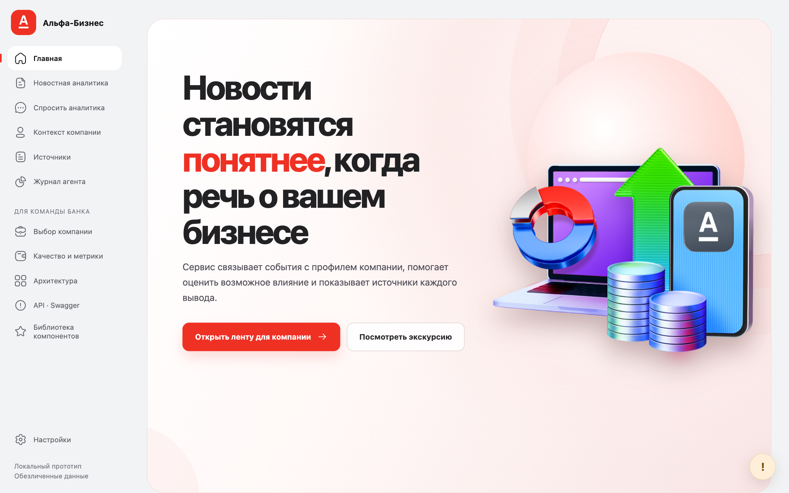
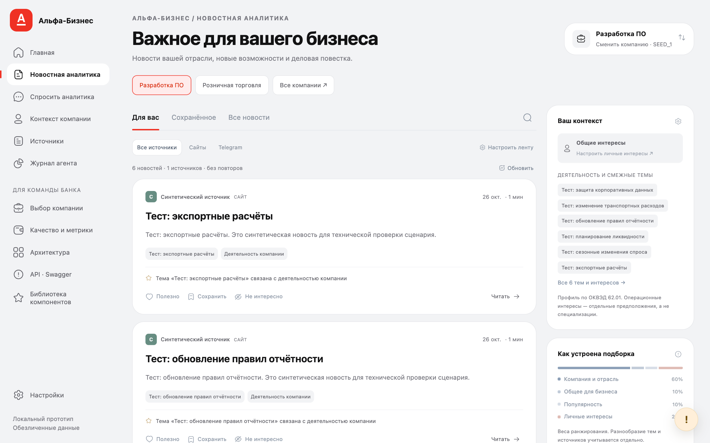
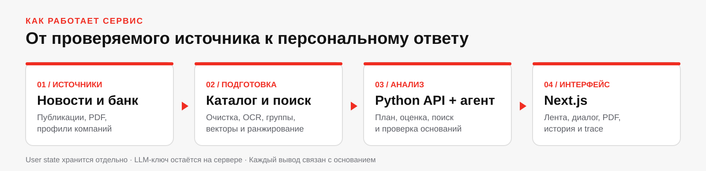

# Alfa — персональная новостная аналитика для бизнеса

## Продовый стенд - https://alfa.aezakmi.org/ с запущенными парсерами, и реальными данными. Парсеры работают в реальном времени. В репозитории запустится демо стенд с синтетикой
Сервис помогает руководителю понять, **как внешнее событие может повлиять на его компанию**. Он подбирает новости с учётом профиля бизнеса, связывает их с проверяемыми источниками и материалами Альфа-Банка, затем даёт условную оценку рисков и возможностей. Пользователь может уточнить вопрос, открыть первоисточник и посмотреть, какие шаги выполнил аналитический агент.

[Запуск](#быстрый-запуск) · [Сценарий](#что-показать-в-прототипе) · [Архитектура](#как-устроено-решение) · [Данные и ограничения](#данные-и-текущий-статус) · [Документация](#где-искать-подробности)

## Зачем нужен проект

Одна и та же новость имеет разное значение для разных компаний. Изменение ставки, экспортных правил или стоимости перевозок может быть важным для одной компании и почти не затрагивать другую. Обычная лента показывает событие; Alfa добавляет контекст компании, возможный механизм влияния и основания вывода.

В ответе разделены четыре слоя:

| Слой | Что получает пользователь |
|---|---|
| Событие | Факты из новости и ссылка на публикацию. |
| Компания | Подтверждённые признаки обезличенного профиля и явно отмеченные неизвестные данные. |
| Банк | Отдельная позиция из доступного материала с названием, датой и страницей PDF. |
| Оценка | Возможные последствия, риски, возможности и условия, при которых вывод изменится. |

Если данных для точного числа нет, сервис даёт полезную сценарную оценку с допущениями. Он не превращает неизвестную сумму договора, валюту или ставку в установленный факт.

## Как выглядит прототип

Главная ведёт к выбору компании и персональной ленте. Ниже — снимки **локального режима с синтетическими данными**: они показывают интерфейс, а не результат на реальном корпусе или подтверждённое качество аналитики.



*Главная страница: постоянный вход в сценарий новостной аналитики.*



*Лента: выбор компании, темы, реакции и контекст, объясняющий подборку.*

## Что уже работает

- **Контекст компании.** Обезличенные профили, признаки деятельности, роль пользователя и сохранённые уточнения. Пользовательское заявление хранится отдельно от проверенного факта.
- **Персональная лента.** Семантический поиск по готовым E5-векторам, фильтры качества и даты, reranker, разнообразие выдачи, реакции и сохранения. Telegram-посты доступны отдельно от новостного обучающего набора.
- **Разбор события.** Собственный ограниченный runtime планирует шаги, ищет материалы банка, готовит условную оценку и проверяет ссылки, цитаты и происхождение существенных тезисов.
- **Диалог и проверка.** Уточняющий вопрос создаёт связанный запуск; доступны история, журнал шагов, первоисточники, PDF-страницы и оценка ответа.
- **Воспроизводимый запуск.** Next.js, Python API и SQLite работают через Docker Compose. Без полного каталога включается явно помеченный синтетический набор для проверки установки.

## Как устроено решение



Сайтовые новости и банковские материалы подготавливаются локально: очистка, группировка, OCR, эмбеддинги и согласованная версия SQLite-каталога. Online-сервис **читает готовый каталог**. Next.js обращается к Python API через `/api/live`; пользовательское состояние хранится отдельно от новостей. Ключ разрешённого LLM-шлюза остаётся на сервере.

Сборщики остановлены по команде владельца проекта. Запуск приложения, smoke-проверки и команды ниже их не возобновляют и не запускают обучение.

## Быстрый запуск

Нужны Docker Engine/Desktop и Docker Compose v2. Из корня репозитория:

```bash
cp .env.example .env  # выполните один раз, если .env ещё нет
docker compose up --build -d
```

Откройте [http://127.0.0.1:3000](http://127.0.0.1:3000). API доступен через Next BFF; [Swagger UI](http://127.0.0.1:3000/docs) описывает маршруты. Без `ALFA_API_KEY` работают лента, профиль, источники и локальные функции, но генерация разбора отключена. Ключ заполняют только в локальном серверном `.env`.

Чистый checkout **не содержит полного корпуса и весов**. В этом случае Compose поднимет небольшой набор из двух вымышленных компаний и шести новостей. Это smoke-режим для проверки сценария. Для работы только с полным каталогом установите `ALFA_REQUIRE_FULL=1` после подготовки данных: запуск завершится ошибкой, если нужных assets нет. [Состав комплекта и восстановление](.ai/tools/SERVING_BUNDLE.md) описаны отдельно.

Для разработки интерфейса без Docker, реальных данных и LLM:

```bash
./run_mock.sh
```

Откройте [http://127.0.0.1:3001/feed](http://127.0.0.1:3001/feed). Скрипт создаёт временный синтетический каталог; по `Ctrl+C` его процессы и временное состояние завершаются. Полная инструкция по окружению, портам и API — в [документации сервиса](.ai/service/README.md).

## Что показать в прототипе

1. На главной откройте аналитику и выберите компанию. В синтетическом режиме доступны две тестовые компании; в полном корпусе поиск идёт по обезличенным ID и признакам.
2. Посмотрите профиль и роль, затем сравните ленты разных компаний. Откройте новость и её исходный материал.
3. При настроенном `ALFA_API_KEY` запустите персональный разбор. Проверьте, что факты события, признаки компании, позиция банка и оценка разделены, а источники открываются.
4. Задайте уточняющий вопрос. Сравните новый ответ с предыдущим, откройте журнал агента и оставьте оценку полезности.

Шаги 1–2 доступны без LLM. Шаги 3–4 требуют серверного ключа, разрешённого шлюза и подходящих источников. Синтетические новости служат только для проверки интерфейса; они не подтверждают качество бизнес-выводов.

## Данные и текущий статус

| Область | Состояние на 26.10.2026 |
|---|---|
| Исходники | Код, тесты, Docker-конфигурация и документация находятся в Git. |
| Корпус | Финальный остановленный срез: 11 904 сайтовые новости и 1 412 Telegram-постов. Актуальный serving-комплект передаётся отдельно от Git. |
| Модели | E5 и reranker предобучены разработчиками. Собственного production-checkpoint после дообучения пока нет; обучение подготовлено, но не запускалось. |
| Качество | Инструменты экспертной оценки готовы, одобренных gold-меток пока 0. Независимые precision/nDCG и точность бизнес-выводов не заявляются. |
| Размещение | Локальный прототип работает; код SSH/rsync-деплоя подготовлен. Внешний full-mode и HTTPS-сценарий ещё не приняты на целевом сервере. |

Пользовательские реакции меняют выдачу, но не обучают веса модели. Факты компании, документы банка и ответы LLM имеют разные уровни достоверности. Перед внешним доступом нужны аутентификация и проверка прав на компанию: тестовый `user_id` не заменяет банковский IAM.

## Проверка и разработка

После запуска Compose можно выполнить smoke без платных LLM-вызовов:

```bash
python -m service.smoke --base http://127.0.0.1:3000/api/live
```

Для проверки изменённого кода в окружении с зависимостями:

```bash
python -m pip install -r service/requirements.lock
python -m unittest discover -s service/tests -v
python -m unittest discover -s recommendations
python -m unittest discover -s insight_generation
cd frontend
npm ci
npm run lint
npm run build -- --webpack
```

Smoke, тесты и сборка интерфейса не запускают сбор новостей, обучение или платные вызовы модели. Изменения модели и корпуса требуют отдельной проверки кандидата и совместимого пересчёта векторов статей и запросов.

## Где искать подробности

| Вопрос | Документ |
|---|---|
| ТЗ кейса и критерии | [Структурированное ТЗ](.ai/ТЗ_НОВОСТНАЯ_АНАЛИТИКА.md) |
| Текущий статус, открытые задачи и журнал | [NEXT_AGENT_HANDOFF](.ai/NEXT_AGENT_HANDOFF.md) |
| Передача команде | [TEAM_HANDOVER](.ai/TEAM_HANDOVER.md) |
| Сервис, API, демонстрация, backup | [service/README](.ai/service/README.md) |
| Корпус и версии данных | [pipeline/README](.ai/pipeline/README.md), [DATA_UPDATE](.ai/pipeline/DATA_UPDATE.md) |
| Обучение и ограничения разметки | [training/README](.ai/training/README.md) |
| Подготовка серверной поставки | [DEPLOYMENT](DEPLOYMENT.md), [SERVING_BUNDLE](.ai/tools/SERVING_BUNDLE.md) |
| Компоненты, лицензии, смоделированные интеграции | [THIRD_PARTY_NOTICES](.ai/THIRD_PARTY_NOTICES.md) |

Основной код находится в `frontend/`, `service/`, `recommendations/`, `insight_generation/`, `pipeline/`, `news_matching/` и `taxonomy/`. Локальные данные, веса, `.env`, кэш, runtime и mutable SQLite state в Git не добавляются.
